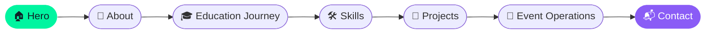

<div align="center">


### `> hello_world.exe` &nbsp;👋

<a href="https://git.io/typing-svg">
  
</a>

<br/>

[](https://krishnaerror.github.io/krishna-portfolio/)
[](https://github.com/KrishnaError)


</div>

---

## 🧬 What is this?

This is not just a portfolio. It is a **single-page, framework-free experience** engineered from scratch with plain **HTML, CSS and vanilla JavaScript**: no React, no npm, no bundler. Just clean code that opens in a browser and works.

> *"Anyone can import a framework. Building it by hand is how you learn what the framework does."*

```text
   ┌──────────────────────────────────────────────┐
   │  index.html  ──►  structure & content        │
   │  style.css   ──►  design, themes, animation  │
   │  script.js   ──►  interactivity & logic      │
   │                                              │
   │  Total dependencies:  0                      │
   │  Build commands:      0                      │
   │  Just open it. It works.                     │
   └──────────────────────────────────────────────┘
```

---

## ⚡ Feature Arsenal

| | Feature | What it does |
|---|---|---|
| 🌗 | **Dark / Light Theme** | One-click toggle, preference remembered between visits |
| ⌨️ | **Command Palette** | Press `Ctrl + K`, `Cmd + K` or `/` to jump anywhere instantly |
| ✍️ | **Typewriter Roles** | Hero text types and erases my roles in real time |
| 🎯 | **Filterable Skills** | Click a category and the skill cards reorganise live |
| 📈 | **Scroll Progress Bar** | Shows exactly how far through the page you are |
| ✨ | **Reveal-on-Scroll** | Sections glide in as you reach them |
| 🧭 | **Active Nav Tracking** | The menu highlights the section you are reading |
| 📱 | **Fully Responsive** | Built for phones, tablets and desktops |
| 📋 | **Contact Helper** | Prepares a message and copies it to your clipboard |

---

## 🗺️ Site Map



<details>
<summary><b>📂 Click to expand: what's inside each section</b></summary>

<br/>

- **Hero:** animated intro and profile card
- **About & Education:** my story and learning journey
- **Skills:** filterable cards across technologies
- **Projects:** academic work, concepts and mini-projects
- **Event Operations:** real-world, on-the-ground experience managing events
- **Contact:** reach me and find me on GitHub

</details>

---

## 🎮 Try These

1. Hit **`Ctrl + K`** and start typing a section name.
2. Flip the **theme toggle** and refresh the page. Your choice stays.
3. Click different **skill filters** and watch the cards react.
4. Scroll slowly and watch the **progress bar** and **reveal effects**.

---

## 🚀 Run It in 10 Seconds

```bash
# 1. Clone
git clone https://github.com/KrishnaError/krishna-portfolio.git

# 2. Enter
cd krishna-portfolio

# 3. Open index.html in your browser. That's it. No npm install.
```

Or use the **Live Server** extension in VS Code for instant reloads.

---

## 🧰 Tech Stack

<div align="center">

| Layer | Tech |
|:---:|:---:|
| **Markup** | HTML5 (semantic) |
| **Styling** | CSS3 (variables, grid, flexbox, animations) |
| **Logic** | Vanilla JavaScript (ES6+) |
| **Typography** | Google Fonts |
| **Hosting** | GitHub Pages |

</div>

---

## 🧠 What I Learned Building This

- Structuring a multi-section site without any framework
- Theme systems using **CSS custom properties** and `localStorage`
- Smooth UX with `IntersectionObserver`-style reveal and scroll logic
- Keyboard-first navigation and accessibility basics
- Writing responsive layouts that don't break on small screens

---

## 📁 Project Structure

```text
krishna-portfolio/
├── index.html    # Page structure & content
├── style.css     # Design system, themes, animations
├── script.js     # Interactivity & features
└── README.md     # You are here 📍
```

---

## 🌐 Deploy Your Own

1. Fork this repo
2. Go to **Settings → Pages**
3. Set source to **main branch / root**
4. Your site goes live at `https://<your-username>.github.io/krishna-portfolio/`

---

## 📬 Let's Connect

<div align="center">

[](https://github.com/KrishnaError)

**If this project impressed you, drop a ⭐. It keeps me building.**

<br/>

```text
 ┌────────────────────────────────────────────┐
 │   while (alive) { learn(); build(); ship(); }  │
 └────────────────────────────────────────────┘
```


</div>
